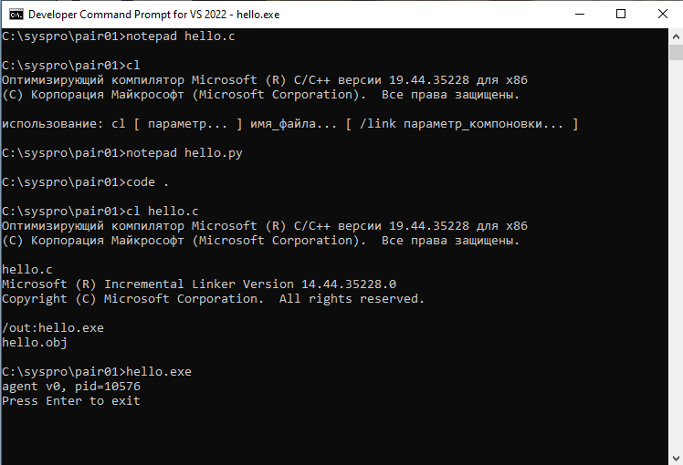
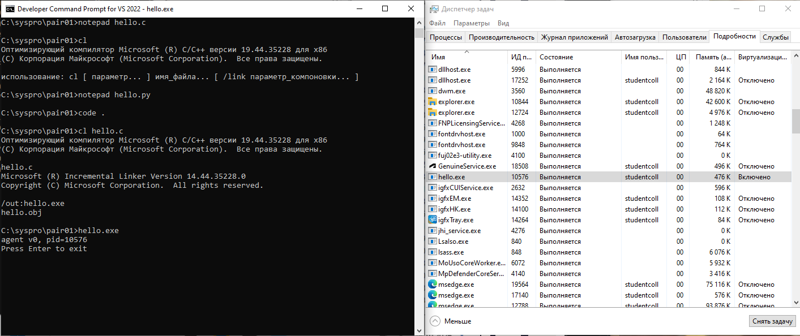
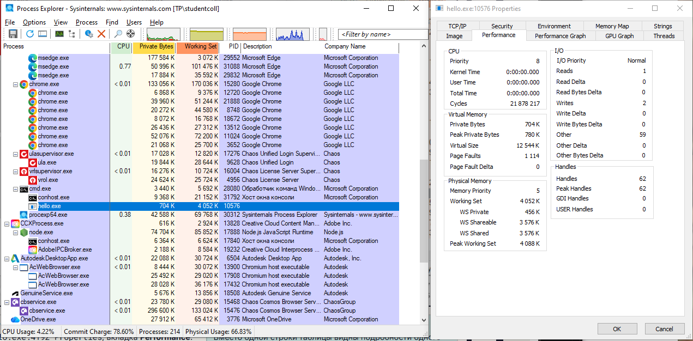
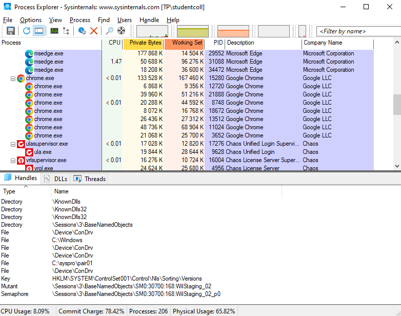
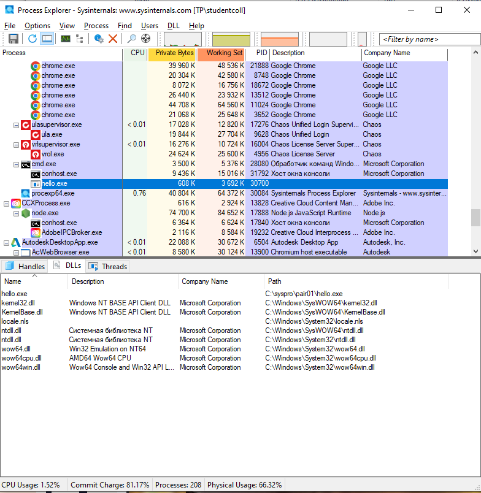
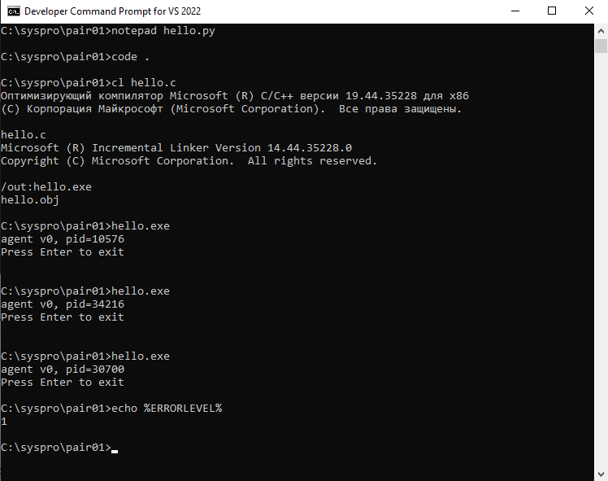
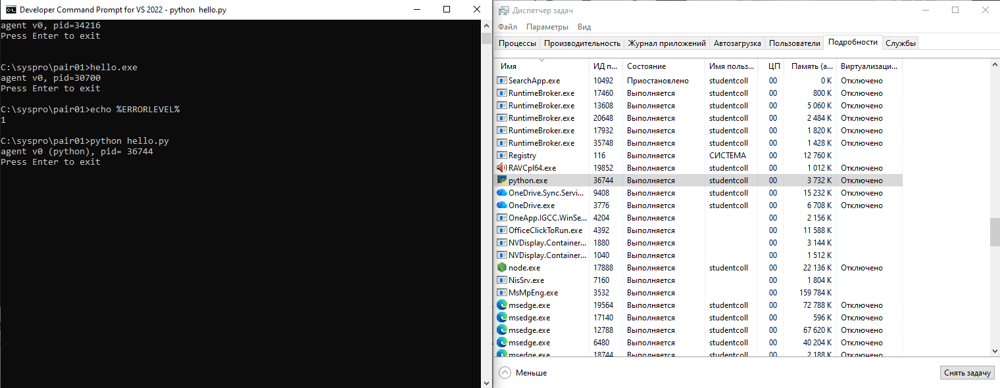
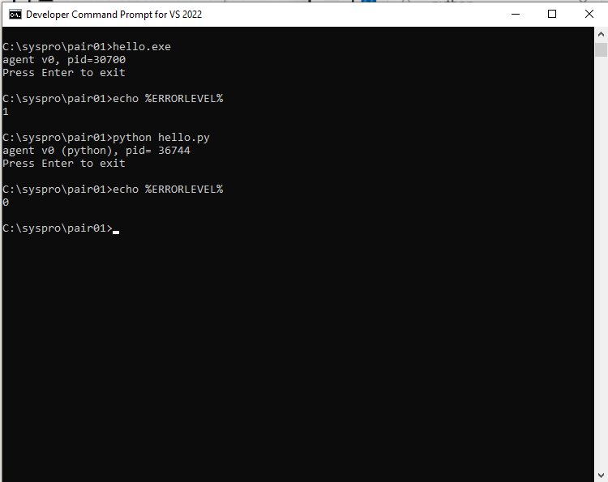

# ЛР 1. Процесс изнутри

Система: `Windows` · компилятор: `Оптимизирующий компилятор Microsoft (R) C/C++ версии 19.44.35228 для x86`

## Программа на C
Программа напечатала PID `10576`, монитор показал PID `10576`.
Память процесса в мониторе: `476 K`. Процессорное время: `0:00:00.000`.
Пока программа ждёт Enter, процессорное время не растёт, потому что `процессор нужен только в момент запуска программы: далее он не работает`.
Дескрипторов у процесса: `4`. Ввод и вывод ведут в `\Device\ConDrv`.
Системные библиотеки в процессе: `ntdll.dll`.
После завершения из монитора терминал напечатал `ничего`, код завершения `1`.

## Программа на Python
Имя процесса в мониторе: `python.exe`, PID `36744`, память `3680 K`.
Памяти больше, чем у программы на C, примерно в `8` раз.
Общая библиотека у программ на C и Python: `ntdll.dll`.
Код завершения при обычном выходе: `0`.

Не получилось: всё получилось без особых проблем.
ИИ: не использовал.

## Снимки экрана

