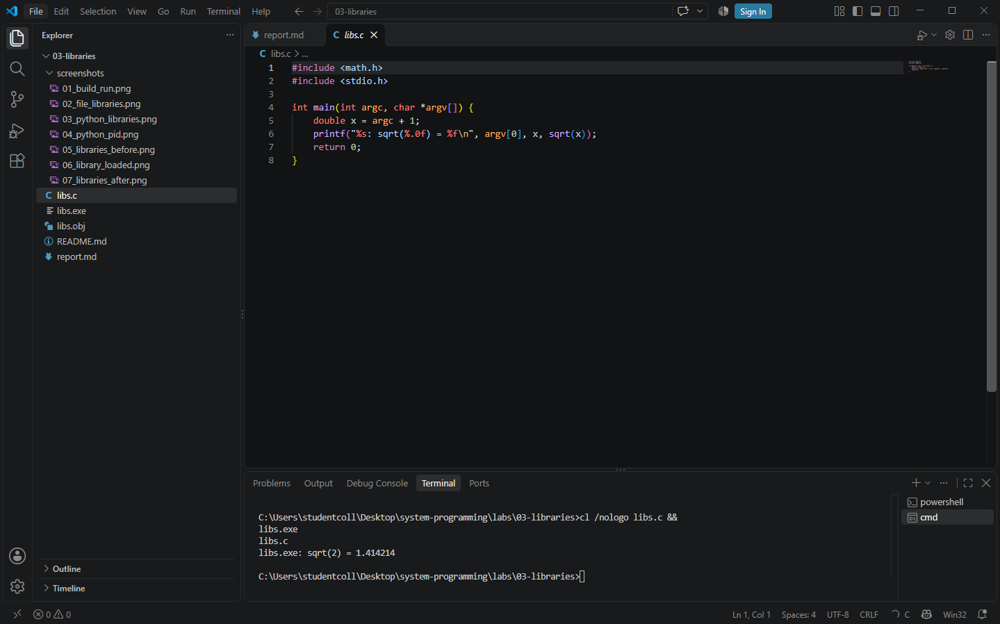
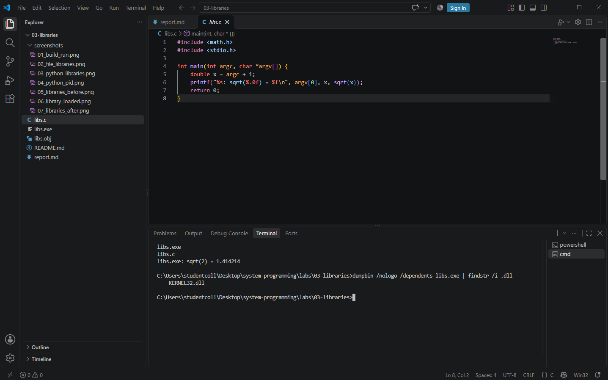
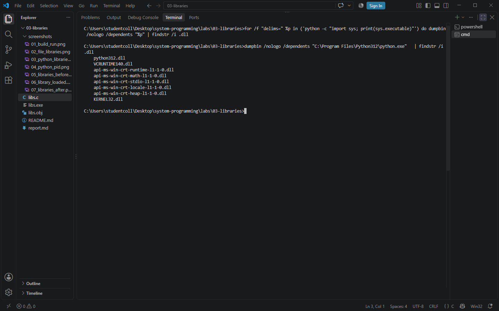
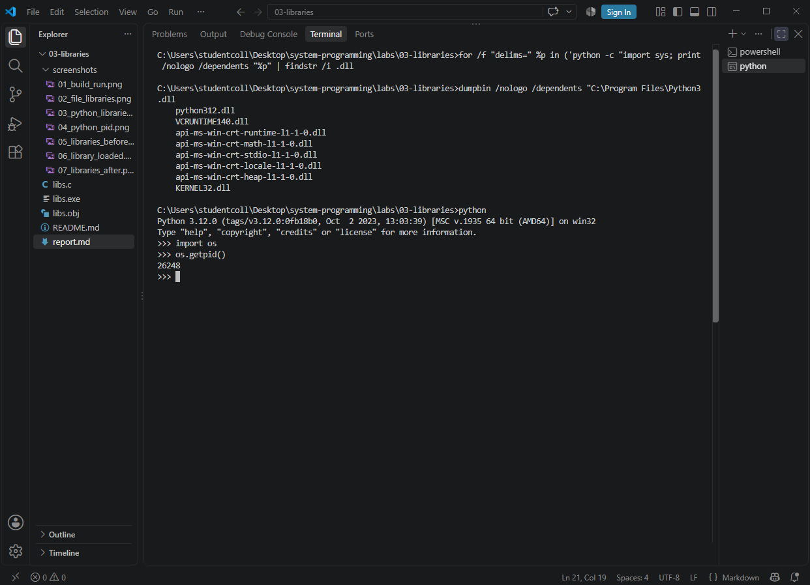
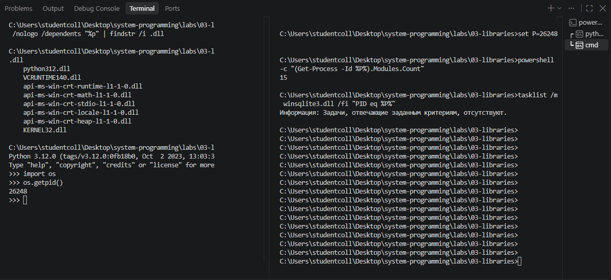
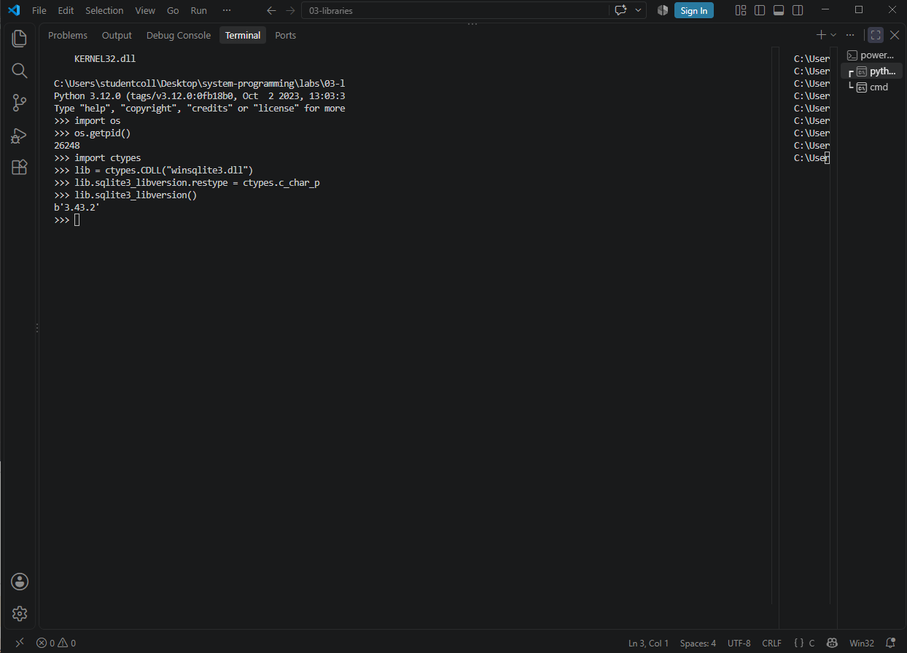
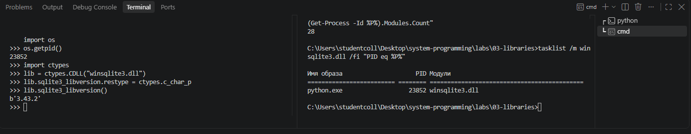

# ЛР 3. Библиотеки программы

Система: `Windows`.

## Библиотеки файла
Программа напечатала: `libs.exe: sqrt(2) = 1.414214`.
Команда для списка библиотек файла: `dumpbin /nologo /dependents libs.exe | findstr /i .dll`
Библиотеки libs: `KERNEL32.dll`
Почему в списке нет отдельной математической библиотеки (или почему она есть): `компилятор сам копирует нужные части библиотеки в exe (пример статической компоновки), поэтому отдельного файла библиотеки не присутствует`.
Где лежит интерпретатор Python (файл или библиотека): `python314.dll`

## Библиотеки процесса
PID Python: 26248
Библиотек в процессе до ctypes.CDLL: `15`, после: `28`
Загруженная библиотека и её полный путь: `winsqlite3.dll`
Функция вернула: `b'3.43.2'`

Не получилось: всё получилось. Только я на последнем шаге случайно закрыла вкладку, так что пришлось перезапускать пайтон и номер процесса немного другой на скринах. На результат в целом это не особо влияет.
ИИ: не использовал.

## Снимки экрана

