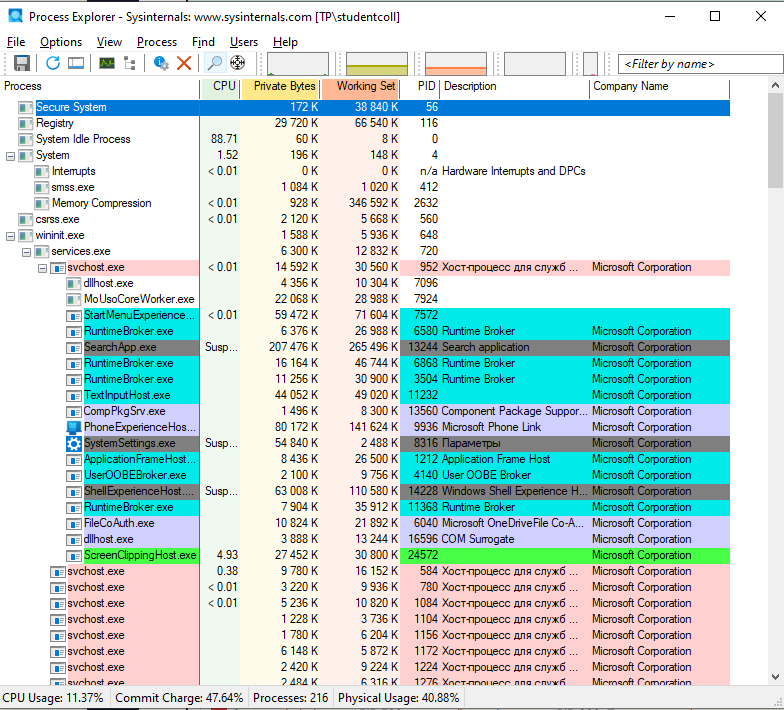
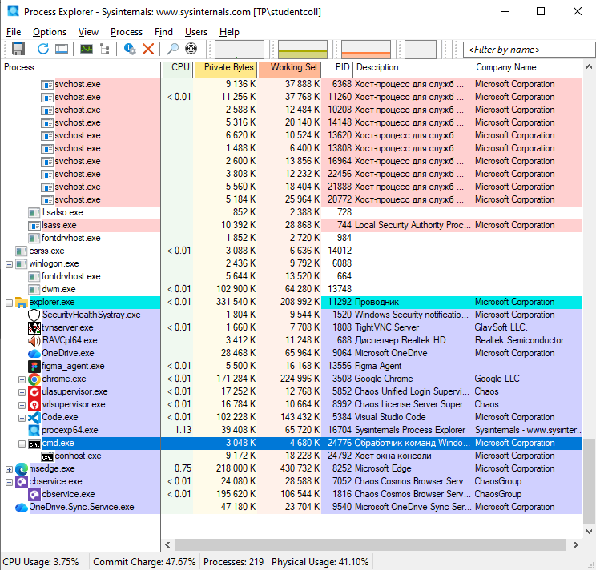
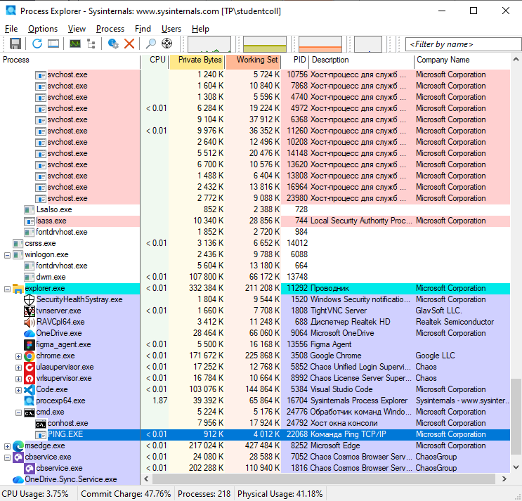
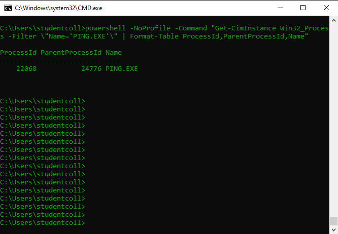
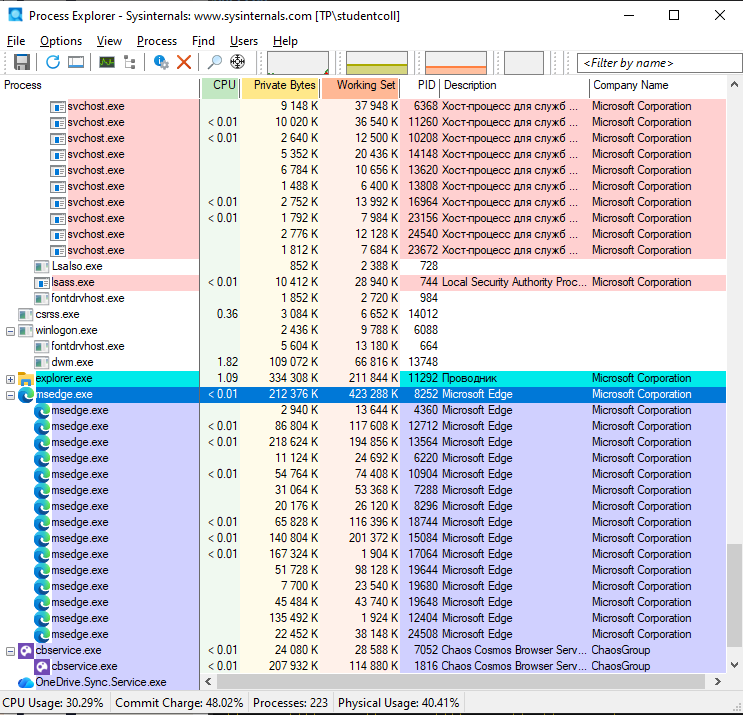
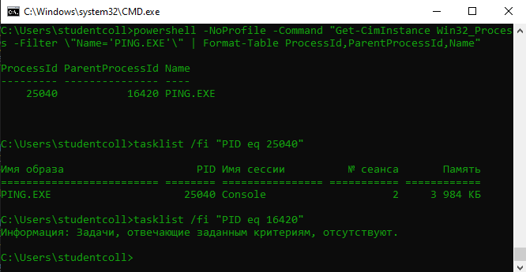
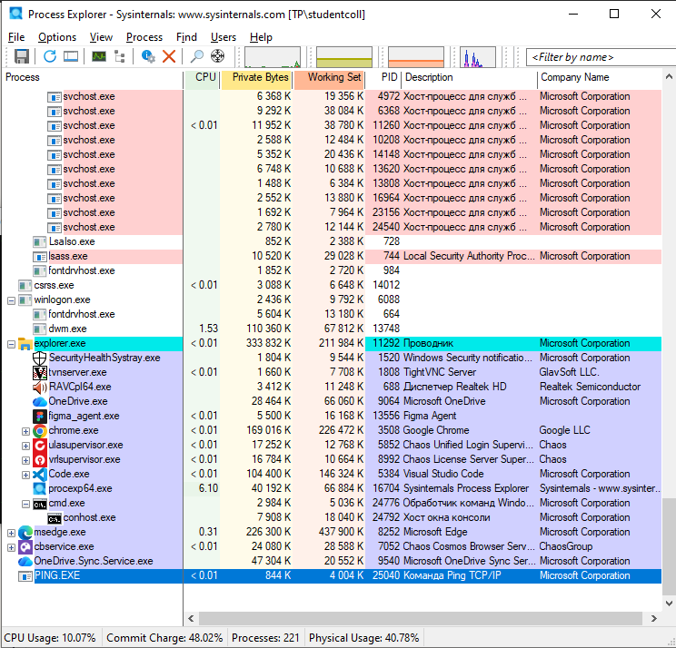

# ЛР 4. Дерево процессов

Система: `Windows`

## Дерево
Процесс в начале дерева и его номер: `Secure System, PID - 56`.
Цепочка родителей терминала (имя и номер): `explorer.exe, PID 11292 -> cmd.exe, PID 24776 -> conhost.exe, PID 24792`.
Дочерний процесс: номер `22068`, родитель `24776`.
Команда, которой проверен родитель: `powershell -NoProfile -Command "Get-CimInstance Win32_Process -Filter \"Name='PING.EXE'\" | Format-Table ProcessId,ParentProcessId,Name"`.
Процессов у браузера и имя процесса вкладок: `процессов - 15, имя - msedge.exe`.

## Сирота
Номер сироты: `25040`
Номер родителя до и после завершения настоящего родителя: `16420`.
Где сирота стоит в дереве: `у левого края, т.к у процесса нет родителя`.

Не получилось: всё получилось.

## Снимки экрана

### 1. Начало дерева процессов
Шаг 1. Видно: дерево процессов в мониторе: первые процессы системы и их номера.

### 2. Терминал и его родители
Шаг 2. Видно: ветка дерева от процесса терминала вверх до процесса системы.

### 3. Дочерний процесс терминала
Шаг 3. Видно: запущенный из терминала процесс под оболочкой терминала.

### 4. Родитель по команде
Шаг 4. Видно: вывод команды с номером процесса и номером его родителя.

### 5. Процессы браузера
Шаг 5. Видно: раскрытая ветка браузера с дочерними процессами.

### 6. Процесс без родителя
Шаг 6. Видно: команда запуска и номер родителя у оставшегося процесса.

### 7. Сирота в дереве
Шаг 7. Видно: тот же процесс в дереве монитора на новом месте.

