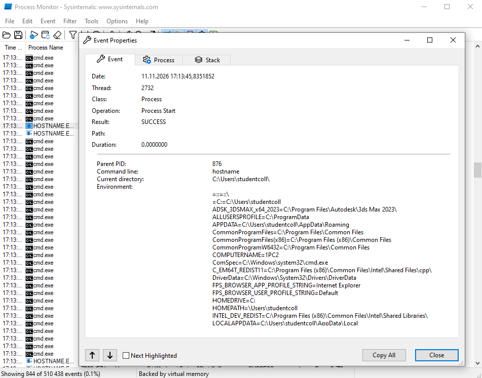
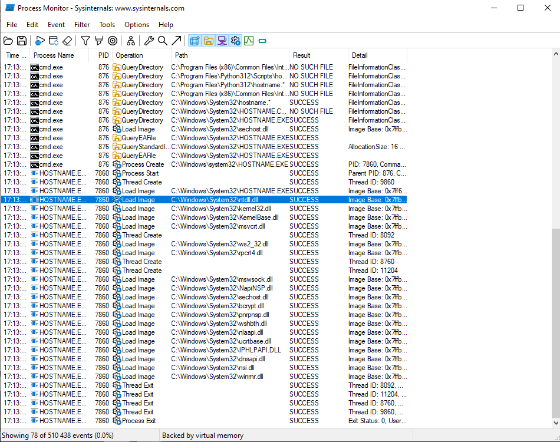
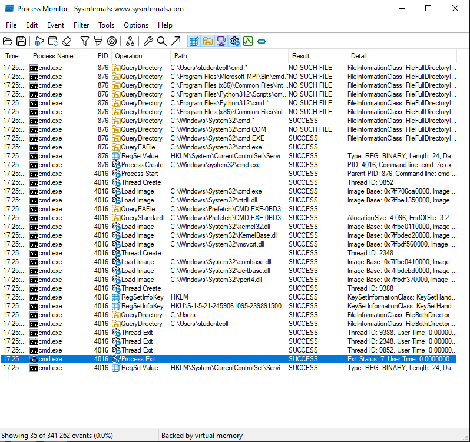
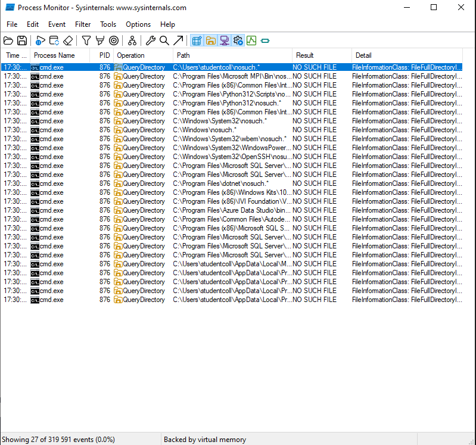
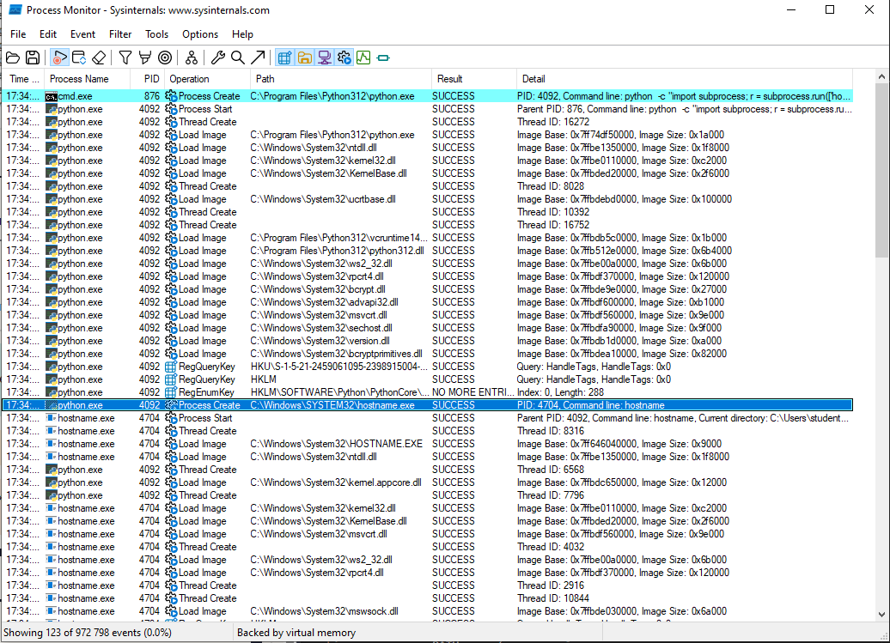

# ЛР 5. Рождение процесса

Система: `Windows`
Программа записи: `Procmon64.exe`

## Рождение
Родитель (имя и номер): `876, cmd.exe`.
Номер нового процесса: `7860`.
Событие или вызов, которым создан процесс: `hostname`.
Библиотек загружено и первая из них: `первая - ntdll.dll, кол-во - 18`.

## Завершение
Код завершения у ребёнка и у родителя: `7`
Программа nosuch: папок проверено `27`, ошибка `NO SUCH FILE`, код `9009`

## Запуск из Python
Номер Python и номер ребёнка: `python - 4092, ребёнок - 4704`.
Чем запуск из Python отличается от запуска из оболочки: `запуск аналогичен`.

Не получилось: всё получилось.

## Снимки экрана

### 1. Рождение процесса
Шаг 1. Видно: запись запуска `hostname`: родитель создаёт процесс, у нового процесса номер родителя.

### 2. Библиотеки нового процесса
Шаг 2. Видно: библиотеки, которые загрузил `hostname`, и первая из них.

### 3. Код завершения 7
Шаг 3. Видно: завершение ребёнка с кодом 7 и тот же код у родителя.

### 4. Программы нет
Шаг 4. Видно: поиск `nosuch` по папкам из PATH и ошибка «не найдено».

### 5. Запуск из Python
Шаг 5. Видно: Python создаёт процесс `hostname`: номер Python и номер ребёнка.

