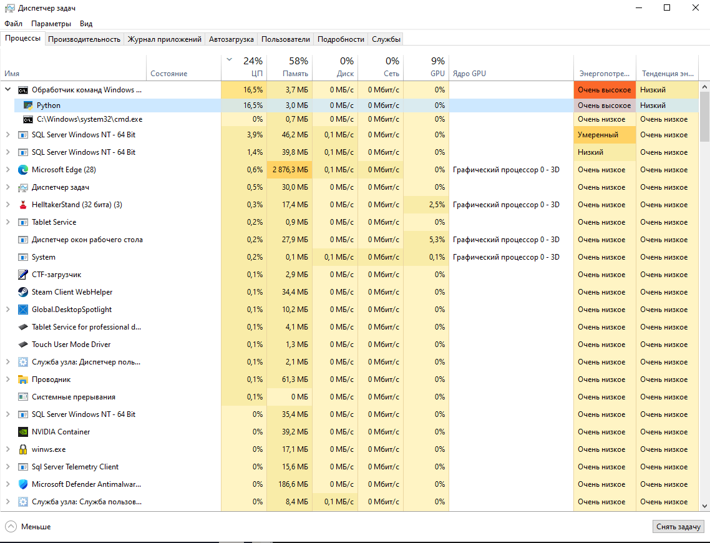
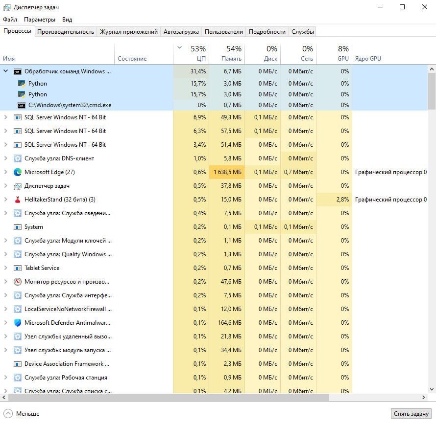
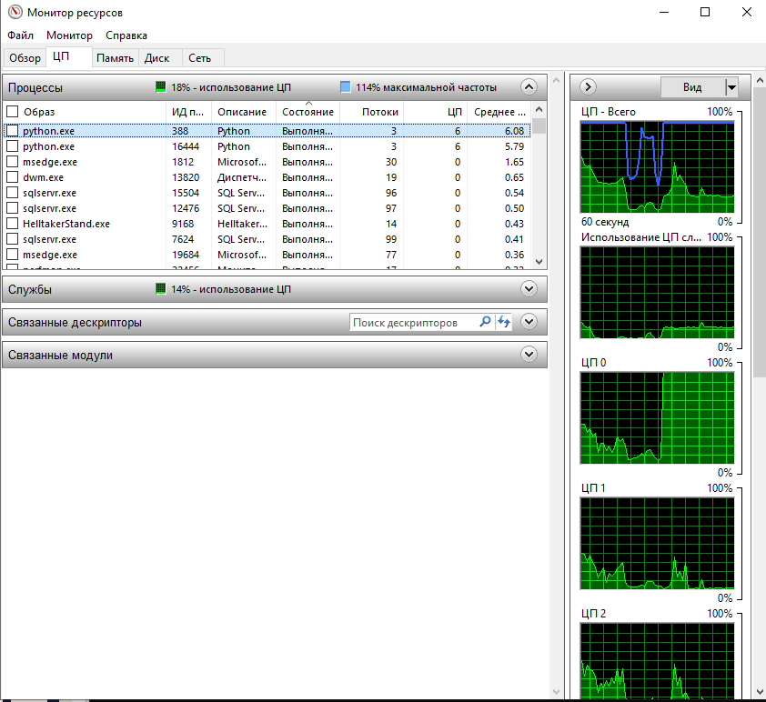
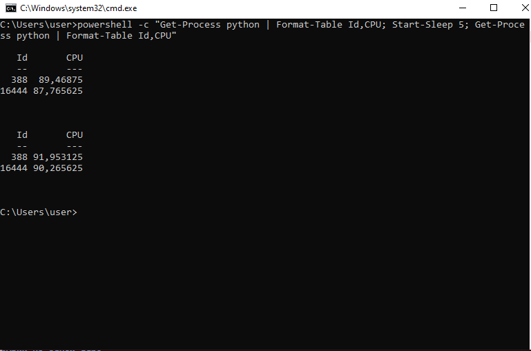

# ЛР 6. Кто загружает процессор

Система: `Windows`
Ядер (логических процессоров): `4 ядра, 8 потоков`

## Одна нагрузка
Процент процесса в мониторе: `16.5%`
Общая загрузка: `24%`
На каких ядрах видна нагрузка: `на всех`

## Две нагрузки
Проценты обеих нагрузок и общая загрузка: `по 15.7% на каждый процесс, общая - 53%`
На одном ядре (в macOS — фоновый режим): `18%`

## Процессорное время
Первый замер, второй замер, пауза: `1 - 89, 2 - 88, пауза 5 секунд, 1 - 92, 2 - 90`
Загрузка по замерам: `0,5`
Почему процент в мониторе не говорит о скорости работы: `потому что процент загрузки показывает долю времени, когда ядро было занято, а не его реальную вычислительную скорость`.

Не получилось: всё получилось.

## Снимки экрана

### 1. Одна нагрузка
Шаг 1. Видно: процесс Python в мониторе: его процент и общая загрузка.

### 2. Две нагрузки
Шаг 3. Видно: два процесса Python и загрузка ядер.

### 3. Нагрузки на одном ядре
Шаг 4. Видно: две нагрузки на одном ядре и их проценты; в macOS — два числа оборотов цикла.

### 4. Процессорное время
Шаг 5. Видно: два замера процессорного времени с паузой между ними.

