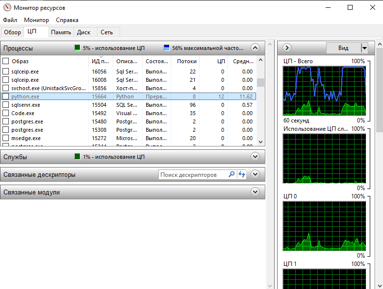
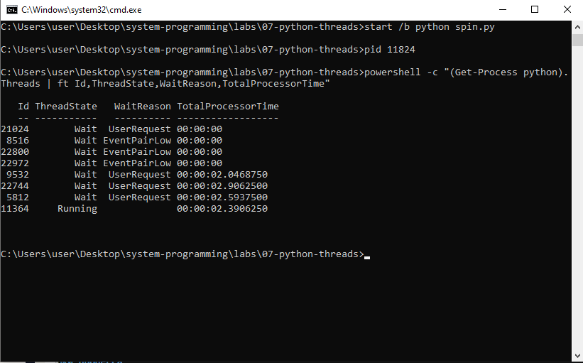
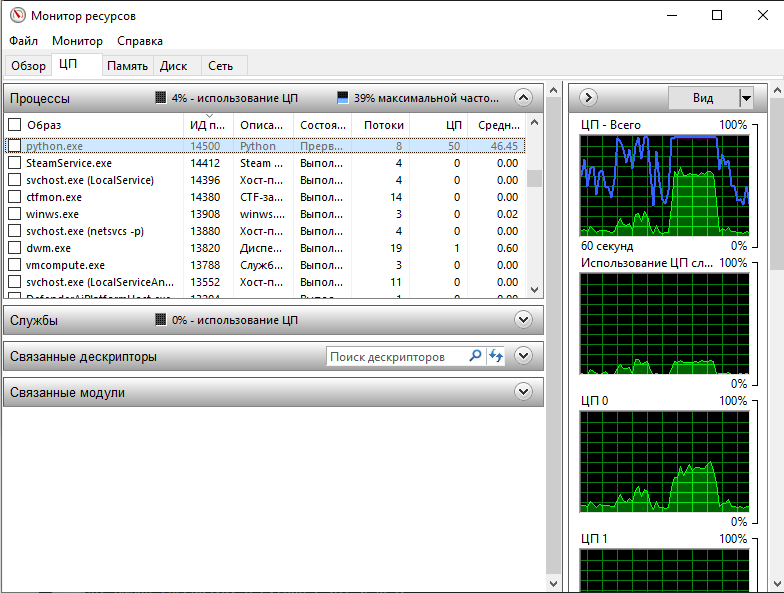
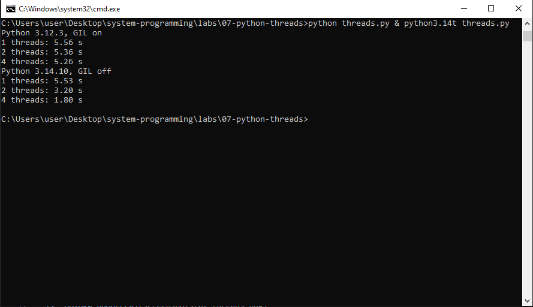

# ЛР 7. Потоки Python и GIL

Система: `Windows`
Ядер (логических процессоров): `4 ядра, 8 потоков`
Версии Python (обычный и без GIL): `3.14.10`

## Python с GIL
Процент процесса и число потоков: `12%, 8`
Сколько потоков выполняется одновременно: `1`

## Python без GIL
Процент процесса и проценты потоков: `50%, 12.5%`

## Время работы
С GIL, 1 / 2 / 4 потока: `5.56, 5.36, 5.26`
Без GIL, 1 / 2 / 4 потока: `5.53, 3.20, 1.80`
Без GIL с PYTHON_GIL=1: `6.19, 5.63, 5.65`
Ожидание, 1 и 4 потока: `2.00`
Почему ожидающие потоки ускоряются и с GIL: `ждущий поток отдаёт замок другим потокам, и они ждут одновременно`

Не получилось: всё получилось.

## Снимки экрана

### 1. Четыре потока с GIL
Шаг 1. Видно: процесс Python в мониторе: его процент и число потоков.

### 2. Потоки процесса
Шаг 2. Видно: список потоков процесса: сколько выполняется, сколько ждёт.

### 3. Четыре потока без GIL
Шаг 3. Видно: процесс python3.14t в мониторе: его процент.

### 4. Время работы
Шаг 4. Видно: вывод threads.py в Python с GIL и без.

