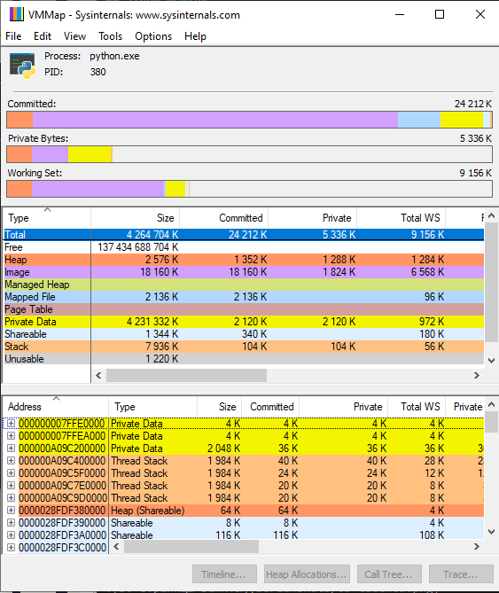
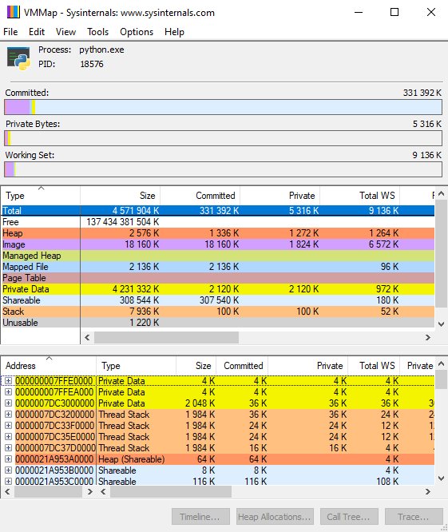
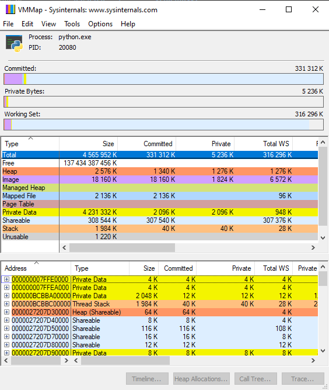
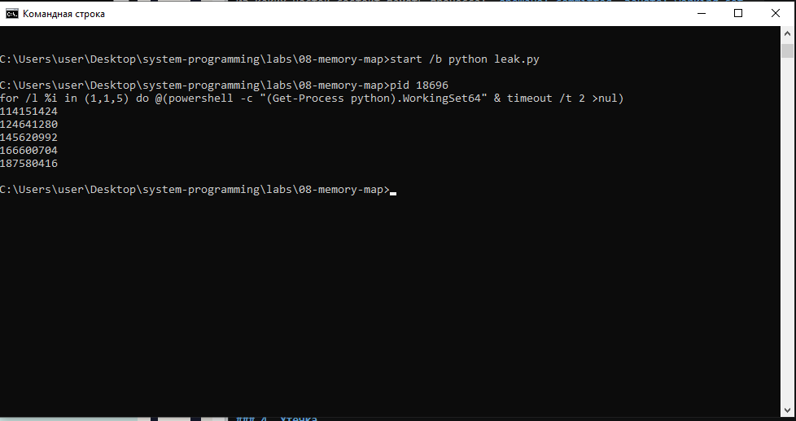

# ЛР 8. Карта памяти

Система: `Windows`
Чем мерил (виртуальная и занятая): `vmmap64.exe`

## Этапы mem.py
Старт: `занято: 9359360, обещано: 4680380116`
Получил 300 МБ: `занято: 9359360, обещано: 4970680416`
Записал в каждую страницу: `занято: 323891200, обещано: 4674285568`
Освободил: `занято: 8896512, обещано: 4359712768`
Почему занятая память выросла только на третьем этапе: ___

## Карта памяти
Из каких частей состоит память процесса: `обещано: committed, занято: working set, общая: shareable`

## Утечка
Пять замеров leak.py: 
`114151424`
`124641280`
`145620992`
`166600704`
`187580416`
На сколько росла память за 2 секунды: `на 20 МБ`

Не получилось: всё получилось.

## Снимки экрана

### 1. Карта памяти
Шаг 2. Видно: карта памяти процесса mem.py на старте и её итог.

### 2. Получено 300 МБ
Шаг 3. Видно: виртуальная память выросла на 300 МБ, занятая — нет.

### 3. Страницы заняты
Шаг 4. Видно: занятая память (в macOS — физический след) после записи в каждую страницу.

### 4. Утечка
Шаг 6. Видно: пять замеров памяти leak.py.

