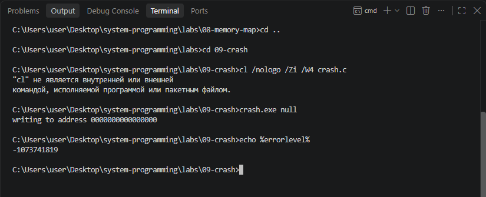
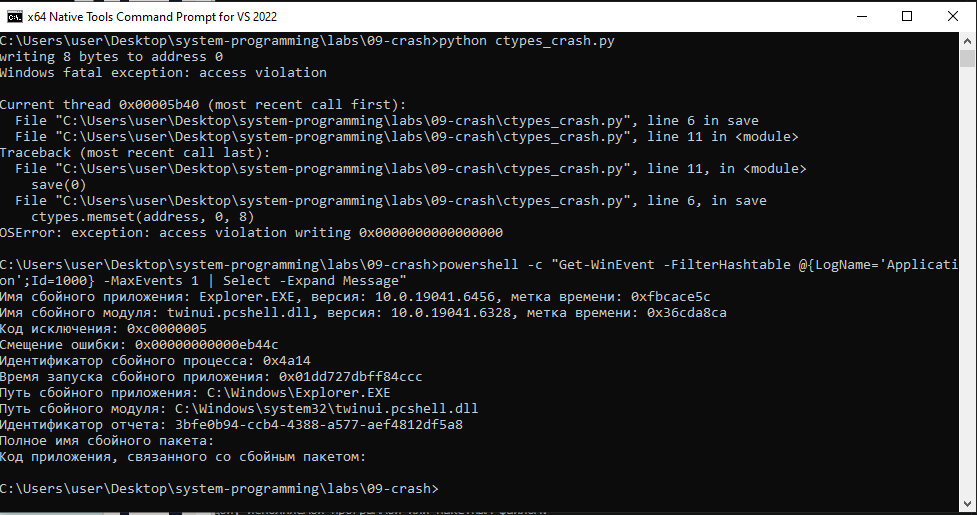
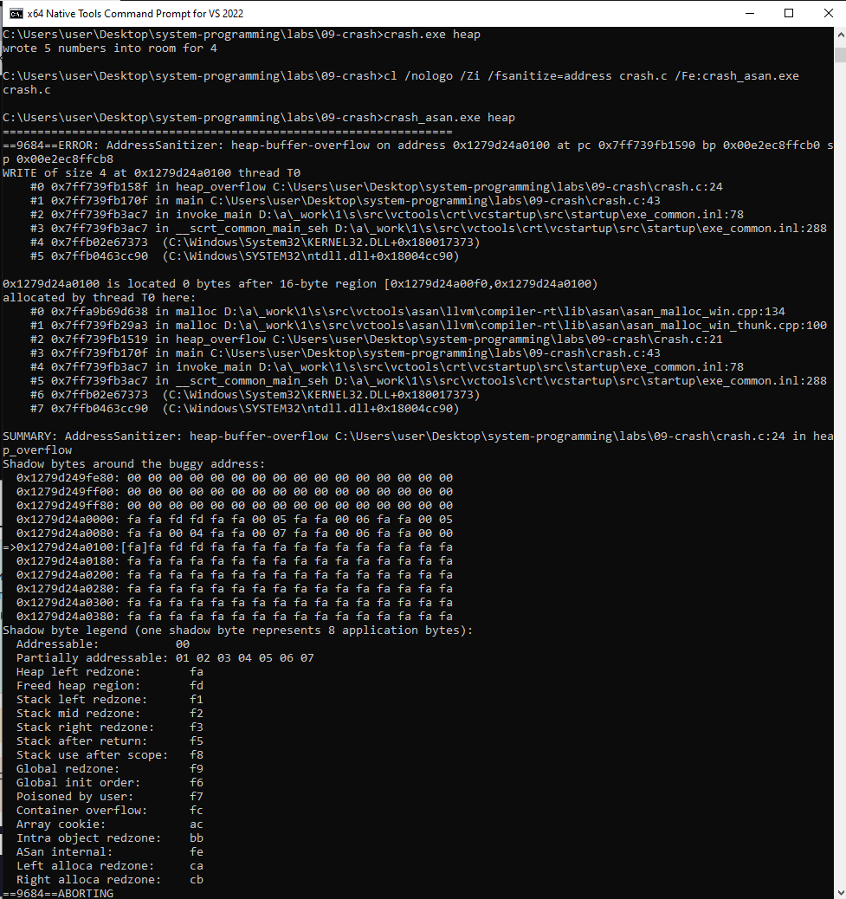
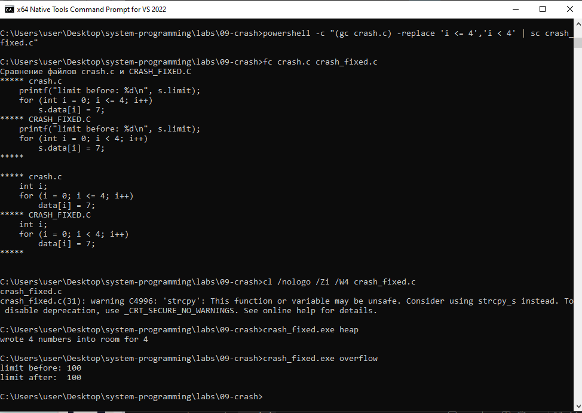

# ЛР 9. Разбор падения

Система: `Windows`
Компилятор: `x64 Native Tools Command Prompt for VS 2022`

## Падение
crash null: что напечатано и код завершения: `-1073741819`
ctypes_crash.py: что напечатал Python: `OSError: exception: access violation writing 0x0000000000000000`
Где система записала падение: `Explorer.EXE`

## Молчаливые ошибки
crash overflow: limit до и после, код: `100, 7, 0`
crash heap без проверки: `wrote 5 numbers into room for 4`
AddressSanitizer для heap: вид ошибки и строка: `heap-buffer-overflow, 24`
AddressSanitizer для uaf: вид ошибки и две строки: `heap-use-after-free, 32-33`

## Исправление
Что изменено и что напечатала исправленная программа: `i <= 4 заменено на i < 4, wrote 4 numbers into room for 4, limit before: 100/limit after:  100`

Не получилось: всё получилось.

## Снимки экрана

### 1. Падение
Шаг 1. Видно: запуск crash null и код завершения.

### 2. Падение Python
Шаг 2. Видно: вывод ctypes_crash.py и запись системы о падении.

### 3. Отчёт AddressSanitizer
Шаг 4. Видно: вывод crash heap без проверки и с AddressSanitizer (на Windows с ARM — без проверки).

### 4. Исправление
Шаг 6. Видно: разница файлов и вывод исправленной программы.

